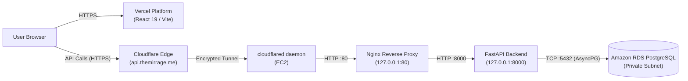
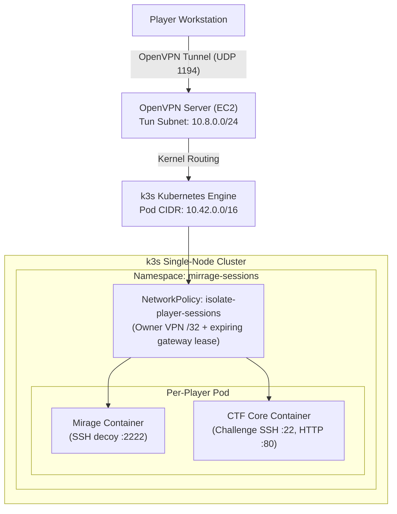

# MIRRAGE Architecture Overview

This document specifies the technical architecture, data flows, network topology, and infrastructure components of the MIRRAGE cybersecurity deception and capture-the-flag (CTF) platform.

---

## 1. Production Architecture

The production environment separates the public-facing web tier from private compute resources and data stores. The user interface is served globally via content delivery networks, while the application programming interface (API) runs on dedicated cloud compute with strict ingress filtering.

### Production Web and API Data Flow



### End-to-End Request Path

1. **User Browser**: The user accesses the web application over HTTPS at `https://themirrage.me` or `https://www.themirrage.me`.
2. **Frontend Delivery (Vercel)**: Static React single-page application assets are served via Vercel's global edge network.
3. **API Routing**: Client API requests target `https://api.themirrage.me`.
4. **Cloudflare Tunnel**: Cloudflare Edge handles Transport Layer Security (TLS) termination and routes inbound HTTP requests through an outbound-only encrypted tunnel established by the `cloudflared` daemon running on the Amazon Elastic Compute Cloud (EC2) instance. No public inbound ports are opened on EC2 for HTTP/HTTPS.
5. **Reverse Proxy (Nginx)**: The `cloudflared` daemon passes traffic locally to Nginx listening on `127.0.0.1:80`. Nginx applies proxy headers (`X-Real-IP`, `X-Forwarded-For`, `X-Forwarded-Proto`) and forwards requests to FastAPI.
6. **Application Core (FastAPI)**: FastAPI processes requests on `127.0.0.1:8000`, enforces JSON Web Token (JWT) authentication, and coordinates platform services.
7. **Database Storage (Amazon RDS)**: Data persistence is managed through Amazon Relational Database Service (RDS) PostgreSQL in a private security group reachable solely by the EC2 instance.

---

## 2. Private Player Infrastructure

Sandbox environments for challenges and honeypots are isolated inside a dedicated Kubernetes cluster on EC2. Access is restricted exclusively to authenticated players connected via a secure Virtual Private Network (VPN).

### Private Sandbox Data Flow



### Sandbox Session Lifecycle

1. **VPN Ingress**: The player establishes an OpenVPN connection to the EC2 host on UDP port 1194 using client credentials generated by the platform. The player is assigned an IP address in the `10.8.0.0/24` subnet.
2. **Cluster Routing**: The EC2 kernel routes traffic destined for the pod network (`10.42.0.0/16`) through the local container network interface bridge.
3. **Session Provisioning**: When a challenge session is initiated via the API, the backend provisions a dedicated pod within the `mirrage-sessions` Kubernetes namespace.
4. **Dual-Container Isolation**:
   - **Mirage SSH decoy (`port 2222`)**: An ordinary SSH environment; the advertised command-telemetry/deception pipeline remains separate work.
   - **CTF Core (`SSH port 22, HTTP port 80`)**: The target challenge container containing objectives, flags, and vulnerabilities discoverable through honeypot investigation.
5. **Access Enforcement**: A default-deny namespace policy, per-session owner `/32` policy and expiring gateway binding restrict access. See [player isolation](player-isolation.md) for deployment requirements and acceptance tests.

---

## 3. Component Overview

| Component | Technology Stack | Hosting / Deployment | Configuration Details |
| :--- | :--- | :--- | :--- |
| **Frontend** | React 19, TypeScript, Vite, Tailwind CSS v4 | Vercel | Hosted at `themirrage.me` and `www.themirrage.me`. API queries point to `https://api.themirrage.me`. |
| **Backend API** | FastAPI, Python 3.13, Uvicorn | AWS EC2 via systemd | Runs as `mirrage-backend.service`, bound to `127.0.0.1:8000`. Async SQLAlchemy session management. |
| **Primary Database** | Amazon RDS PostgreSQL | AWS Private Subnet | Managed relational store accessible exclusively from the EC2 instance security group via port 5432. |
| **Reverse Proxy** | Nginx | AWS EC2 | Binds to `127.0.0.1:80`. Forwards traffic to Uvicorn at `127.0.0.1:8000` with standard forward headers. |
| **Public Ingress** | Cloudflare Tunnel (`cloudflared`) | AWS EC2 systemd service | Ingress tunnel exposing `api.themirrage.me` without opening inbound firewall ports on EC2. |
| **Container Orchestration** | k3s (Lightweight Kubernetes) | AWS EC2 (Local node) | Manages container lifecycles in the `mirrage-sessions` namespace using custom security contexts. |
| **VPN Gateway** | OpenVPN 2.x, Easy-RSA | AWS EC2 | Binds UDP 1194. Manages client authentication, subnet allocation (`10.8.0.0/24`), and routes to `10.42.0.0/16`. |
| **Player Sandbox Pod** | Dual-container Pod (Mirage + CTF) | k3s Pod | Contains `mirage` (SSH 2222) and `ctf` (SSH 22, HTTP 80), pinned to the VPN gateway node. Capabilities are dropped and a subset is added for the exercise. |

---

## 4. Network Topology and Traffic Routing

The platform employs multi-tiered network segmentation to isolate administrative traffic, game play sandboxes, and database communications.

```
+---------------------------------------------------------------------------------------+
|                                    AWS EC2 HOST                                       |
|                                                                                       |
|   +--------------------------+                      +-----------------------------+   |
|   |    OpenVPN Server        |                      |     cloudflared Ingress     |   |
|   |    Subnet: 10.8.0.0/24   |                      |     api.themirrage.me       |   |
|   +------------+-------------+                      +--------------+--------------+   |
|                |                                                   |                  |
|                | (tun0)                                            v (127.0.0.1:80)   |
|                v                                    +--------------+--------------+   |
|   +------------+-------------+                      |     Nginx Reverse Proxy     |   |
|   |   Kernel Routing Tables  |                      +--------------+--------------+   |
|   |   (ip_forward = 1)       |                                     |                  |
|   +------------+-------------+                                     v (127.0.0.1:8000) |
|                |                                    +--------------+--------------+   |
|                v (cni0)                             |     FastAPI Backend         |   |
|   +------------+-------------+                      +--------------+--------------+   |
|   |    k3s Pod Network       |                                     |                  |
|   |    CIDR: 10.42.0.0/16    |                                     | (TCP 5432)       |
|   +--------------------------+                                     v                  |
|                                                     +--------------+--------------+   |
|                                                     | Amazon RDS PostgreSQL (VPC) |   |
|                                                     +-----------------------------+   |
+---------------------------------------------------------------------------------------+
```

### Subnet Allocations

- **OpenVPN Subnet (`10.8.0.0/24`)**:
  - Reserved per certificate in the database and applied through OpenVPN client-specific configuration; no dynamic pool.
  - Gateway interface (`tun0`) resides at `10.8.0.1`.
  - Pushes route `10.42.0.0 255.255.0.0` to clients upon connection.
- **k3s Pod CIDR (`10.42.0.0/16`)**:
  - Default pod network managed by k3s Flannel CNI.
  - Player pods are dynamically provisioned with IP addresses in this block.
- **Docker Bridge (Legacy Development) (`172.20.0.0/24`)**:
  - Reserved for standalone local compose development environments (`mirrage_net`).
  - Container static IPs: Mirage (`172.20.0.10`), CTF (`172.20.0.20`).

### Ingress & Egress Restrictions (NetworkPolicy)

The namespace policy denies ingress and egress by default. Each session gets an
owner-specific `/32` policy for TCP 22, 80 and 2222; outbound connections are limited
to that owner's configured callback ports. DNS/internet access is denied by default.
The gateway independently filters VPN/pod address pairs, protects host services,
blocks peer clients and closes leases at expiry. See [player-isolation.md](player-isolation.md)
for the single-node/IPv4 scope, rollout, reboot/renewal behavior and required tests.

## Database migration lifecycle

Alembic revisions in `backend/migrations/versions` define the database schema.
Startup verifies the recorded migration head before seeding or worker cleanup;
it does not create tables. Existing unversioned databases require checked adoption
before explicit upgrade. See [database-migrations.md](database-migrations.md) for
revision history, protected rollback and backup/recovery preparation.
